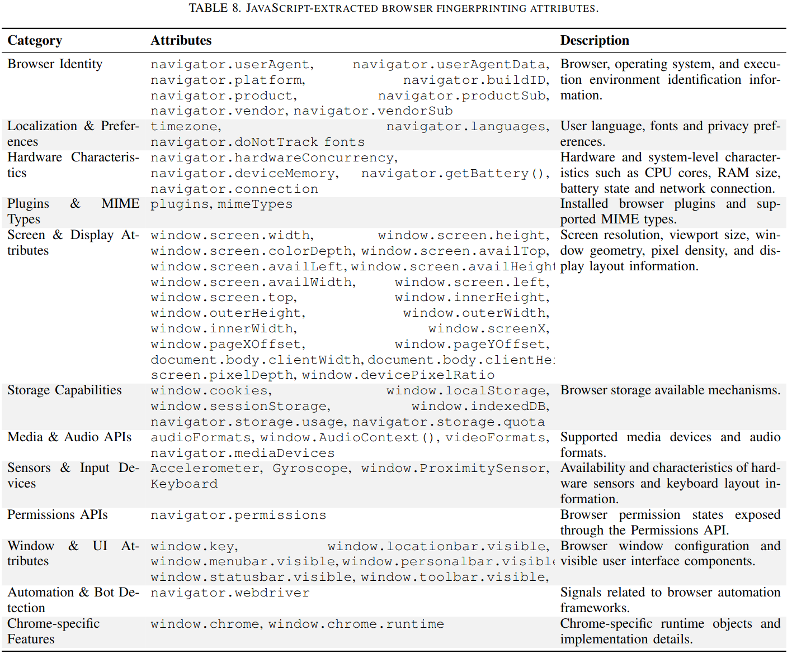
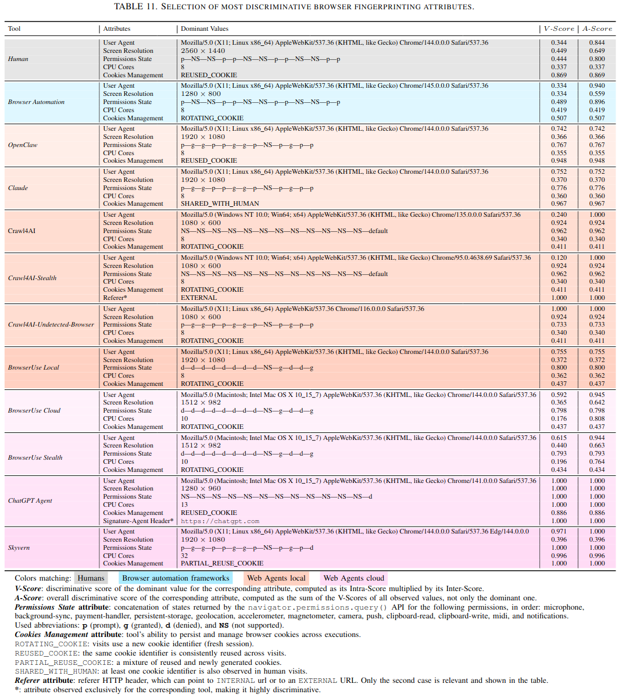

# List of Collected Attributes

We collected attributes at three levels:

1. **Network-level attributes:** We extracted the source IP address, source port, and JA4 TLS fingerprint from TLS ClientHello packets using `tshark`.

2. **HTTP-level attributes:** We collected HTTP header attributes from Nginx access logs (see [Nginx Access Log Format](./NginxAccessLogFormat.md)).

3. **Browser-level attributes:** We collected browser fingerprinting attributes directly from the browser using JavaScript, as illustrated below.

### Most Discriminative Browser Attributes

The figure below summarizes the most discriminative browser fingerprinting attributes, as identified by the metrics described in our paper.

> **Note:** Some attributes can take multiple values for a given tool. In such cases, we report only the value with the highest V-Score.